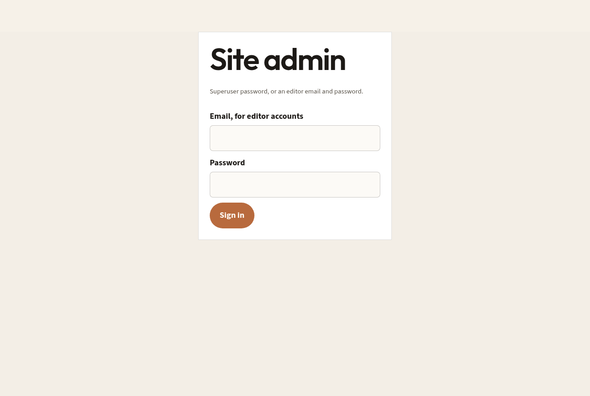
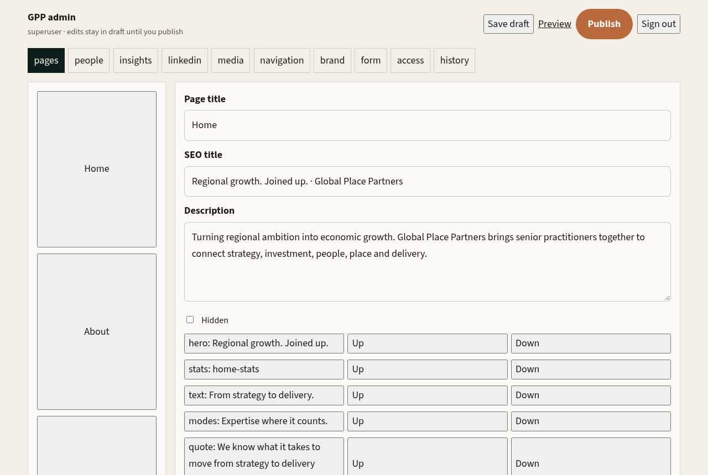
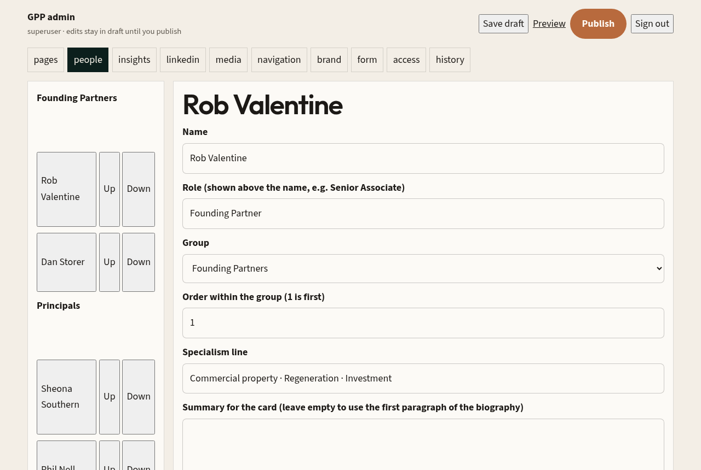
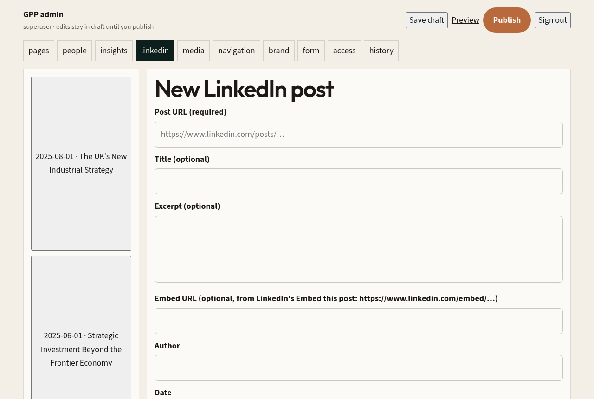
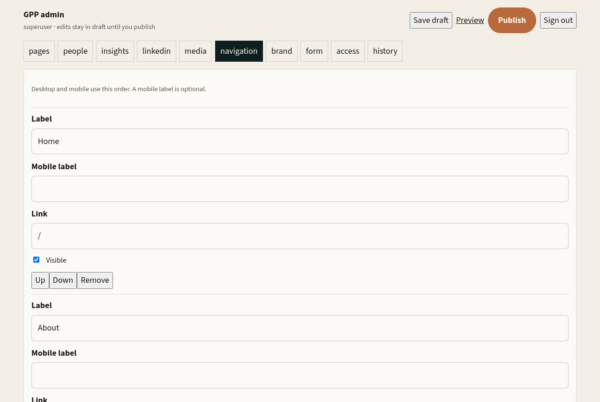

# Global Place Partners website: Admin guide

This guide explains how to edit the website through its built-in admin area. Part 1 is for site editors and needs no technical knowledge. Part 2 is for whoever sets up and hosts the site.

---

# Part 1: For site editors

## 1. Signing in

1. Go to **your-site-address/admin** (for example `https://globalplacepartners.com/admin`).
2. Enter your password and press **Sign in**.
   - **Superuser (main admin):** leave the email box empty and type the main admin password. That password is set by the technical team on the server (see Part 2); it cannot be changed from inside the admin.
   - **Editor:** type the email address and password a superuser created for you in the **access** tab.
3. You stay signed in for 24 hours on that browser. Press **Sign out** (top right) when you finish on a shared computer.



**Superuser or editor?** Both can edit all content and publish. Only a superuser can create or remove editor accounts, restore an earlier version of the site, see stored contact-form enquiries, and change the enquiry recipient address.

## 2. The most important idea: draft, Save draft, Publish

There are two copies of the site content: the **draft** (what you are working on) and the **published** version (what visitors see).

The bar at the top of the admin has four buttons:

| Button | What it does |
|---|---|
| **Save draft** | Saves your changes to the draft. Visitors see nothing yet. |
| **Preview** | Opens the site in a new tab showing the **last saved** draft. Press Save draft first, or your latest edits will not show. |
| **Publish** | Saves the current draft and makes it live for everyone. A snapshot is kept in **history**. |
| **Sign out** | Ends your session. |

Things that follow draft-then-Publish: **pages and sections, people, navigation, brand, form**.

Things that go live **as soon as you save them** (no Publish needed): **insights articles, LinkedIn posts, media library uploads, editor accounts**.

> There is no "unsaved changes" warning. If you close the tab or sign out before pressing Save draft, your edits are lost.

## 3. The tabs

`pages · people · insights · linkedin · media · navigation · brand · form · access · history`

### 3.1 pages



- **Left column:** every page. Click one to edit it. At the bottom, type a **New page title** and press **Create page** to make a new page. Its address is made from the title (e.g. "Case studies" becomes `/case-studies`). New pages are not added to the menu automatically; add them in the **navigation** tab.
- **Page title, SEO title, Description:** the title, the text shown in the browser tab and search results, and the search-result summary.
- **Hidden:** hides the whole page from visitors.
- **Delete page:** only shown for pages you created. The built-in pages cannot be deleted (you can hide them).
- **Section list:** the page is made of sections, top to bottom. Click a section to edit it. Use **Up / Down** to move it. Hidden sections show "Hidden:" in front.
- **Add section:** pick a type from the drop-down and press **Add section**. It is added at the bottom; move it with Up/Down.

#### Section fields

Every section has the same editing panel. Not every field is used by every type (see the table below).

| Field | Meaning |
|---|---|
| Section type | What kind of block it is (see table below). |
| Eyebrow | The small label above the heading. |
| Heading | The main heading. Press Enter to start a new line. On some sections, the second and later lines are shown in the copper accent colour; whether that happens is set per section in the code and cannot be changed in the admin. |
| Supporting line | A short line under the heading (used by the hero and side-by-side layouts). |
| Body | Paragraph text. Leave a blank line between paragraphs. |
| Image address / image picker | Picture shown with the section. Choose from the media library or paste an address. |
| Image description | Alt text for screen readers. Always fill in for meaningful images. |
| Link 1 / Link 2 (label + address) | Buttons. Addresses can be pages on this site (e.g. `/contact`) or full web addresses. |
| Background | `paper, cream, white, sage, deep, green, pine, teal`. |
| Spacing | How much space above and below. |
| Layout | `stack` (one column), `split` (two columns), `split-reverse` (two columns, swapped). |
| First link style | Whether the first link appears as a solid button. |
| Items shown as | For **text** sections with items: a list, or **tiles** (the 3 × 2 grid used for the six Growth Model areas). |
| Show a row of team portraits | For **text** sections: adds the strip of team photos (used on the home page People teaser). |
| Hide section | Hides it without deleting it. |
| Items | The repeating entries (title + text, plus extra fields for some types). Add, edit, reorder and remove items here. |
| Duplicate / Delete | Copy the section just below it, or remove it. |

#### Section types

| Type | What it shows | Fields that matter |
|---|---|---|
| **hero** | The big opening banner at the top of a page. | Eyebrow, heading, supporting line, body, image, links. |
| **text** | General text block. Can show items as a list or as tiles, and can show the portrait row. | All general fields, items, "Items shown as", portraits. |
| **stats** | A row of large figures. | Items: **title** is the big figure, **text** is the label under it. |
| **quote** | A pull-quote band with artwork. | Heading is the quote, body is the attribution, image is the artwork (e.g. constellation graphic). |
| **linkedin** | Shows the latest LinkedIn posts from the **linkedin** tab. | Eyebrow, heading, body, and how many posts to show. |
| **modes** | A list of numbered rows (e.g. ways of working). | Heading, body, items. |
| **diagram** | An image with labelled points (Growth Model). | Image, items (each with a group). |
| **diagnostic** | The interactive self-check questions. | Items (label, question text), a note, and the result text. In the result, text before the first colon is shown in bold. |
| **people** | The full team grid, grouped, with biography pop-ups. Content comes from the **people** tab. | Heading/eyebrow only. |
| **insights** | The list of articles from the **insights** tab. | Heading/eyebrow only. |
| **contact** | The enquiry form. Labels are edited in the **form** tab. | Heading, body. |
| **cta** | A closing call-to-action band with buttons. | Heading, body, links. |

#### The `[Stat]` placeholder

The home page stats row ships with placeholder figures such as **[Stat]**, because no real numbers were supplied. Any stat whose title starts with `[` is shown in a muted placeholder style so it is obviously not final. To finish it:

1. pages → Home → click the **stats** section.
2. In each item, replace `[Stat]` in **title** with the real figure (e.g. `40+`) and put the description in **text**.
3. Save draft, Preview, then Publish.

If you have no real figures, select the section and tick **Hide section** instead. Do not publish placeholder figures as if they were facts.

### 3.2 people



The left column lists everyone by group: **Founding Partners**, **Principals**, **Senior Associates**.

**Add someone:** press **Add employee**, then fill in:

- **Name** and **Role** (shown above the name, e.g. "Senior Associate").
- **Group**: which heading they appear under on the People page.
- **Order within the group**: 1 is first. You can also use the **Up / Down** buttons in the list.
- **Specialism line**: short line under the name, e.g. "Commercial property · Regeneration · Investment".
- **Summary for the card**: a few lines on the card. Leave empty to use the first paragraph of the biography. Long summaries are cut off on the card.
- **Full biography**: shown in the pop-up when a visitor clicks the person. Leave a blank line between paragraphs. If this is empty, the card has no "Read full biography" link.
- **LinkedIn URL**: their profile address (must start with `https://`). Shown as a link in the pop-up.
- **Photo**: **Upload a photo** (JPG, PNG, WebP or GIF, up to 8 MB) or paste an address in **Or photo address**. Square, head-and-shoulders photos work best; the site applies the same colour treatment to every portrait so mismatched backgrounds look consistent.
- **Crop horizontal / Crop vertical / Crop zoom**: sliders to position the face in the square frame.
- **Portrait description**: alt text, e.g. "Portrait of Jane Smith".
- **Hide from the site**: keeps the person in the admin but removes them from the site.

**Delete someone:** select them, press **Delete employee**, confirm. This removes them from the draft; they disappear from the site when you **Publish**.

Remember: people changes need **Save draft** and **Publish**. (An uploaded photo is stored straight away, but it is only attached to the person once you save.)

### 3.3 insights

Articles for the Insights page. Press **New article**, fill in title, summary, body (for an article hosted on this site) or **External URL** (to link to an article elsewhere), slug (the page address), source, category, author, featured image, SEO title and description.

- **Status:** `draft` (not visible), `scheduled` (appears automatically after the **Publish at** date/time), `published` (visible).
- **Featured article:** highlights it on the Insights page.
- **Create article / Save article** saves it and it takes effect **immediately** (according to its status). **Delete article** removes it.

### 3.4 linkedin



LinkedIn posts appear in any **linkedin** section (the home page band and the Insights page), newest date first.

1. Press **Add LinkedIn post**.
2. **Post URL (required):** open the post on LinkedIn and copy the address from the browser bar (it must be a `linkedin.com` address).
3. **Embed URL (optional):** shows the real post inside the site.
   - On LinkedIn, open the post, click the **⋯** (three dots) menu and choose **Embed this post**.
   - LinkedIn shows a piece of code like `<iframe src="https://www.linkedin.com/embed/feed/update/urn:li:share:123..." ...>`.
   - Copy **only the address inside the quotes after `src=`**, starting `https://www.linkedin.com/embed/`, and paste it here. Pasting the whole code will not work; only `linkedin.com/embed/` addresses are accepted.
   - "Embed this post" is only offered for public posts.
4. If you don't use an embed, fill in **Title**, **Excerpt** and optionally **Image address** (or upload an image) so the site shows a card linking to LinkedIn.
5. **Date** (used for ordering), **Author**.
6. Press save. **The post goes live immediately**, no Publish needed. Tick **Hide from the site** to take it down without deleting it, or **Delete post** to remove it permanently.

### 3.5 media

The image library. Type a **Description for the next upload**, then choose a file under **Upload image** (JPG, PNG, WebP, GIF, max 8 MB). It uploads straight away and becomes available in every image picker. For existing images you can change the alt text or **Replace file** and press **Update image**. Replacing a file updates it everywhere it is used.

Tip: resize photos to about 800–1600 px wide before uploading; it keeps the site fast.

### 3.6 navigation



The main menu. For each entry: **Label**, **Mobile label**, **Link** and **Visible**. Use Up/Down, **Remove** and **Add link**. Save draft and Publish.

### 3.7 brand

Site-wide settings: site name, colours, heading and body fonts, logo address and description, public email, footer line, legal footer text, legal links (**Add legal link**) and the canonical site address. Superusers also see the **enquiry recipient** email. Save draft and Publish.

### 3.8 form

The labels and messages of the contact form. Save draft and Publish.

### 3.9 access (superuser only)

Create editor accounts (name, email, password of at least 8 characters) and remove them. Changes take effect immediately. The main superuser password is not managed here (see Part 2).

### 3.10 history

- **Revisions:** every Publish creates a snapshot (the last 40 are kept). A superuser can press **Restore** to bring one back. **Restore makes that version live immediately** and replaces the current draft too.
- **Enquiries (superuser only):** contact-form submissions stored by the site, with whether the email was delivered.

## 4. Images: quick rules

- Upload through the media tab, people tab or any image picker. All end up in the media library.
- Always add a description (alt text).
- Images that came with the site live at `/images/...` addresses; they can be used but only replaced by a developer. To change one, upload a new image and pick it instead.

## 5. Troubleshooting

| Problem | What to do |
|---|---|
| "Invalid password" / can't sign in | Superuser: leave the email empty. Editors: check the email. If the superuser password is lost, the technical team resets `ADMIN_PASSWORD` (Part 2). |
| Signed out unexpectedly | Sessions last 24 hours; also, changing `SESSION_SECRET` on the server signs everyone out. Sign in again. Unsaved changes are lost. |
| My changes don't show in Preview | Press **Save draft** first, then reload the Preview tab. |
| My changes don't show on the live site | Press **Publish**. Then hard-refresh the page (Ctrl/Cmd + Shift + R). |
| A new person doesn't appear | Check they aren't ticked "Hide from the site", are in the right group, and that you published. |
| LinkedIn post shows a card instead of the real post | The embed URL is empty or wasn't accepted. Paste only the `https://www.linkedin.com/embed/...` address. |
| Embedded post is blank | The post may have been deleted or made private on LinkedIn. Remove the embed URL and use title/excerpt instead. |
| Upload fails | Use JPG/PNG/WebP/GIF under 8 MB. |
| Edits disappear after a while (live site) | The site isn't connected to its database. Tell the technical team (Part 2, "Storage"). |
| I published a mistake | A superuser can **Restore** an earlier revision in history, or fix it and publish again. |

---

# Part 2: Technical setup

## Architecture

- React + Vite single-page app (`src/`), served by Vercel as static files.
- Express API (`server/app.js`, exposed on Vercel via `api/index.mjs`) for content, admin and the contact form.
- Content store (`server/store.js`): **Postgres** when `DATABASE_URL` is set, otherwise a JSON file (`data/cms.json`, or `/tmp/gpp-data` on Vercel). Initial content comes from `server/seed.js` the first time the store is empty.

## Environment variables

| Variable | Required | Purpose |
|---|---|---|
| `SESSION_SECRET` | **Yes** | Long random string used to sign admin session cookies. The admin will not work without it. Changing it signs everyone out. |
| `ADMIN_PASSWORD` | **Yes** | The superuser password (sign in with empty email). Change it here to reset it. |
| `DATABASE_URL` | **Yes in production** | Postgres connection string. Without it, edits on Vercel are not saved permanently. |
| `DATABASE_SSL` | No | `true`/`false` to force SSL on/off. SSL is used automatically on Vercel or with `sslmode=require`; `sslmode=disable` turns it off. |
| `RESEND_API_KEY`, `RESEND_FROM_EMAIL` | No | Send contact-form emails via Resend. Without them, enquiries are only stored (history tab). |
| `CONTACT_TO_EMAILS` | No | Comma-separated recipients; overrides the recipient set in brand. |
| `TURNSTILE_SITE_KEY`, `TURNSTILE_SECRET_KEY` | Production | Cloudflare Turnstile spam check on the form. Defaults are Cloudflare's always-pass test keys, which provide no protection. |

Admin passwords for editors are stored hashed (scrypt). Session cookies are HTTP-only, `SameSite=Lax`, `Secure` in production, and expire after 24 hours. The contact form is limited to 5 submissions per hour per IP.

## Deploying on Vercel

1. Import the GitHub repo `rrs77/dangpprevised-v2` into Vercel. Build settings come from `vercel.json` (`npm run build`, output `dist`, `/api/*` routed to the Express app, everything else to the SPA).
2. Create a Postgres database (e.g. Vercel Marketplace → Neon, or any hosted Postgres) and copy its connection string.
3. In Project → Settings → Environment Variables add `SESSION_SECRET`, `ADMIN_PASSWORD`, `DATABASE_URL` and, as needed, the Resend and Turnstile variables. Redeploy.
4. Visit `/admin`, sign in and publish once to confirm saving works.

### Postgres

No manual SQL is needed. On first start the app creates its tables (`cms_state` for content, `cms_media` for uploaded images) and fills them from `server/seed.js` if empty.

Important: once the database contains content, **changes to `server/seed.js` are not applied** to it. Seed changes only affect a brand-new database. Edit live content in the admin. If you point v2 at a database already used by an older version of the site, it will show that older content (the new home sections, stats, quote, LinkedIn band etc. won't appear). Use a fresh database for v2, or add the sections in the admin.

If the database can't be reached at start-up, the app logs `Postgres unavailable; serving the built-in site content.` and serves the seed content; edits in that state are not saved to the database.

### Storage and uploads

- With Postgres, uploaded images are stored **in the database** (`cms_media`) and served from `/api/media/<id>`, so they persist across deploys. Nothing else is required.
- Without `DATABASE_URL` on Vercel, content and uploads go to `/tmp`, which is temporary and per-instance: edits will vanish. Always set `DATABASE_URL` in production.
- Locally without Postgres, content is in `data/cms.json` and uploads in the `data/` folder. Delete `data/cms.json` to reset to the seed.

## Local development

`server/dev.js` does not read a `.env` file, so pass variables in the shell:

```bash
npm install
SESSION_SECRET=dev-secret ADMIN_PASSWORD=dev npm run dev
#   API on http://127.0.0.1:3001, site + admin on http://127.0.0.1:5173

npm run build                      # production build into dist/
SESSION_SECRET=dev-secret ADMIN_PASSWORD=dev npm start
#   serves dist/ and the API together on http://127.0.0.1:3001
```

Add `DATABASE_URL=postgres://...` to test against Postgres.

## Smoke test

With the server running (e.g. `npm start` as above), in another terminal:

```bash
ADMIN_PASSWORD=dev npm run smoke          # BASE defaults to http://127.0.0.1:3001
```

It checks public pages and the API, signs in, edits and publishes a draft (then restores the original text), adds a person with a photo, reorders and deletes them, creates/edits/hides/deletes a LinkedIn post, and tests the contact form. Run it against a local or staging copy, not the live site: it publishes changes while it runs.
